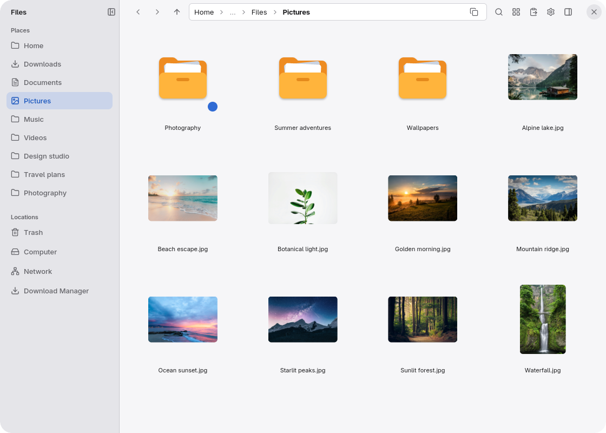
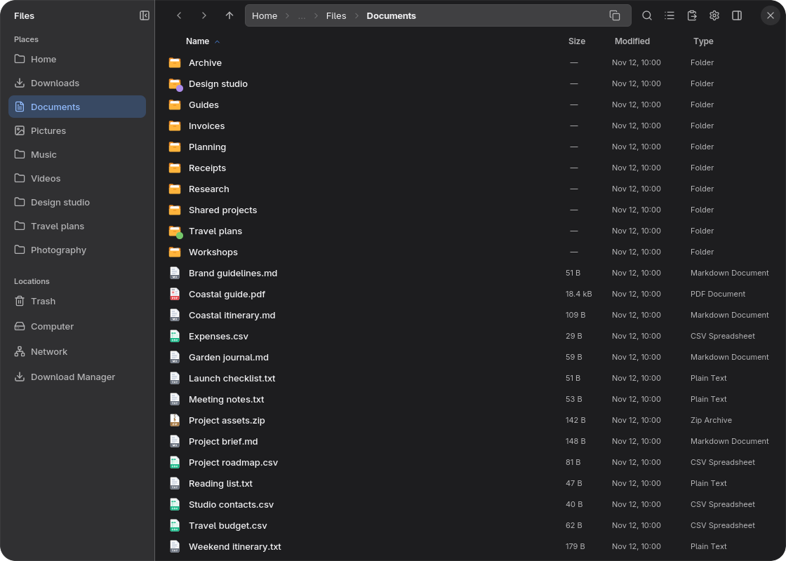
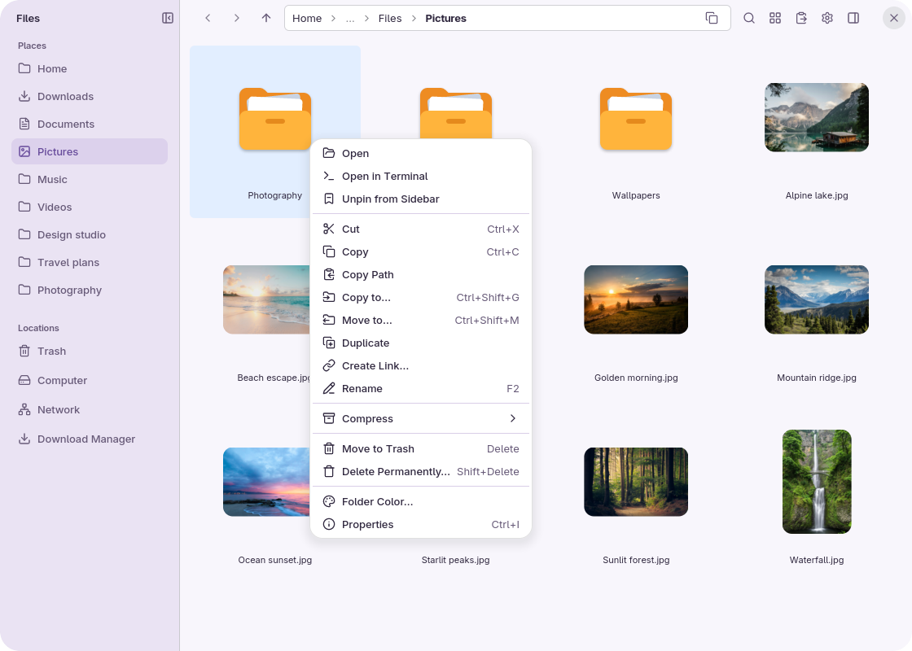
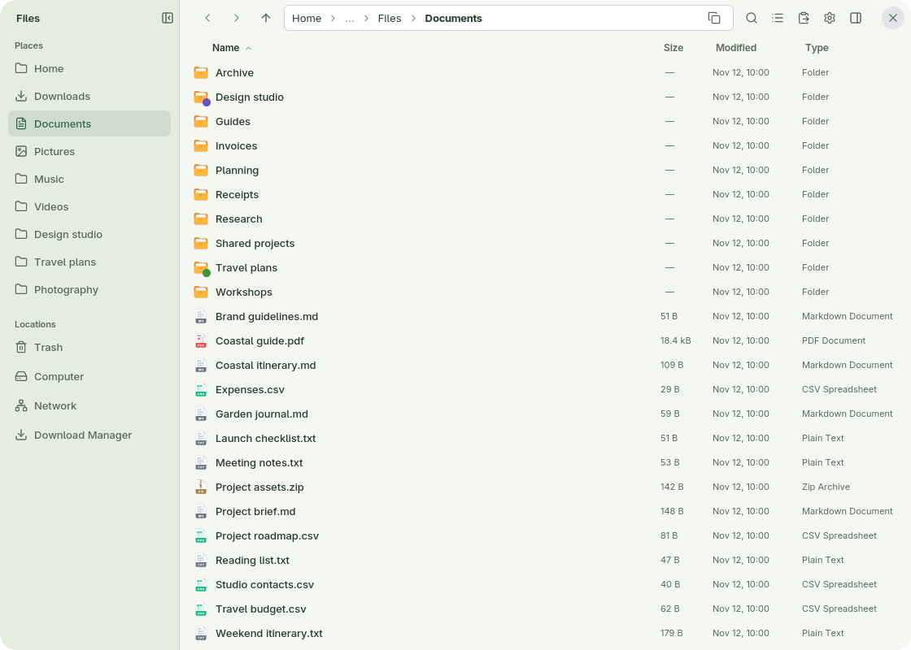
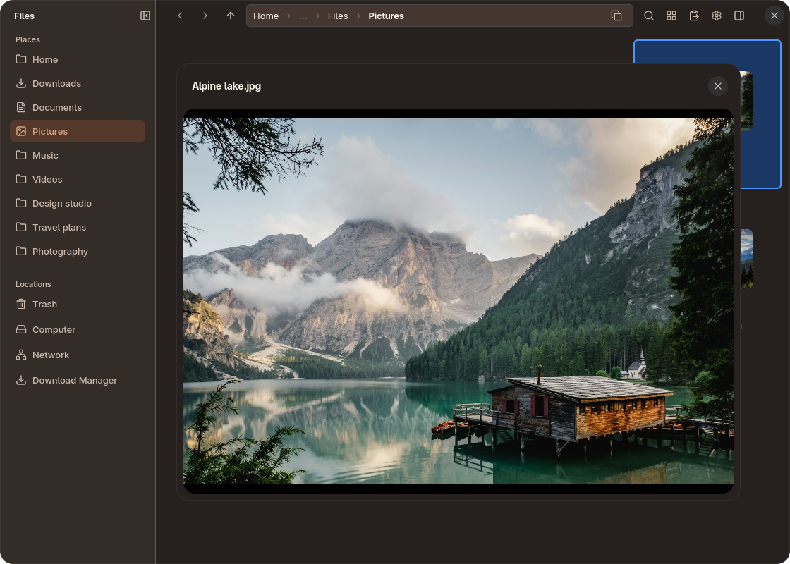
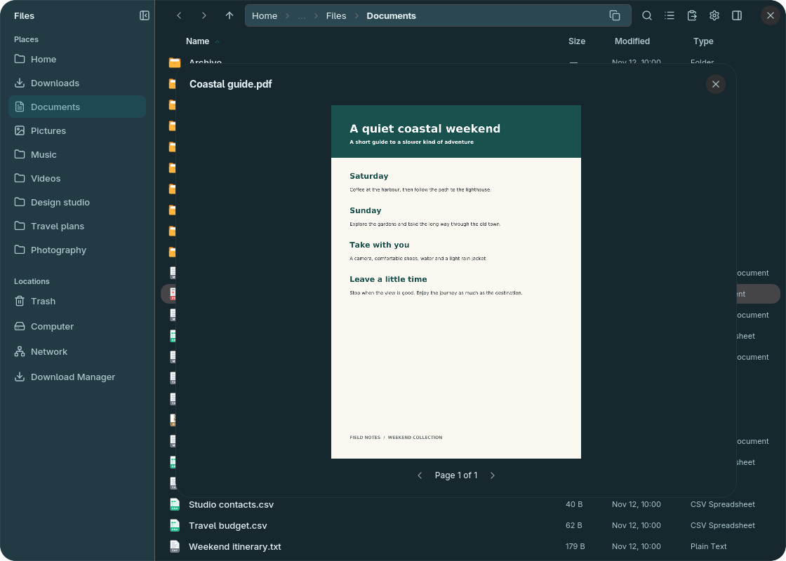
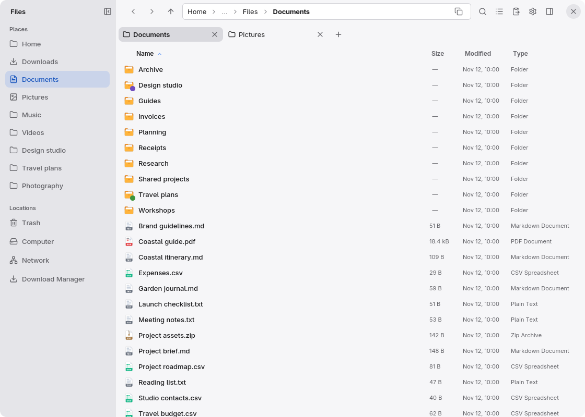
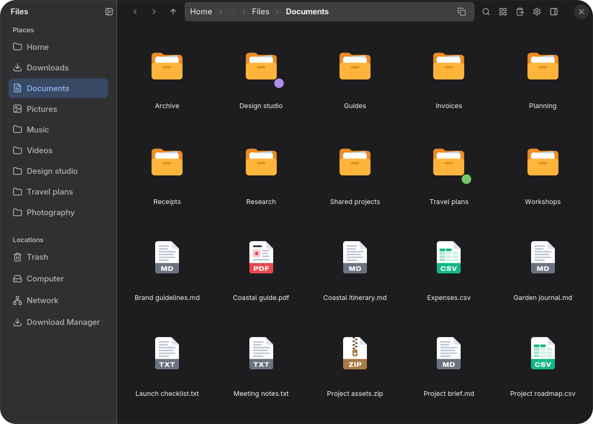

# Files

Browse folders, mounted volumes and remote locations. Built with [enzUI](https://github.com/enz1m/enzui).

<table>
  <tr>
    <td align="center"><a href="docs/screenshots/basic-light.png"></a><br><sub>Pictures · light</sub></td>
    <td align="center"><a href="docs/screenshots/basic-dark.png"></a><br><sub>Documents · dark</sub></td>
    <td align="center"><a href="docs/screenshots/lavender.png"></a><br><sub>File actions</sub></td>
    <td align="center"><a href="docs/screenshots/sage.png"></a><br><sub>Folder list</sub></td>
  </tr>
  <tr>
    <td align="center"><a href="docs/screenshots/ember.png"></a><br><sub>Image preview</sub></td>
    <td align="center"><a href="docs/screenshots/lagoon.png"></a><br><sub>PDF preview</sub></td>
    <td align="center"><a href="docs/screenshots/precision.png"></a><br><sub>Folder tabs</sub></td>
    <td align="center"><a href="docs/screenshots/comfort.png"></a><br><sub>Document grid</sub></td>
  </tr>
</table>

Click a screenshot to enlarge. Screenshots use example files. Sample photographs are from [Unsplash](https://unsplash.com/license).

## Features

- Tabs, search, bookmarks, file properties and Space previews for images, text, audio, video and PDFs.
- Copy, move, rename, trash and restore with conflict handling.
- Archives, downloads, mounted storage and native drag and drop.

## Build and run

Use Rust **1.99.1** (minimum **1.95**), a C/C++ toolchain and pkg-config.
Linux UI builds need Wayland/XKB, GLib/GIO, fontconfig and Vulkan/EGL development support.
PDF previews require Poppler GLib and Cairo development libraries. Audio/video previews
use GStreamer with the base, good, bad and libav plugin sets.

```sh
git clone https://github.com/enz1m/files.git
cd files
cargo build --locked
cargo run --locked
```

Dependencies pin public [enzUI Alpha 0.2](https://github.com/enz1m/enzui/releases/tag/v0.2.0-alpha.1)
and its matching public foundation forks. No sibling framework checkout is needed.
Wayland is enabled by default; use `--features x11` when X11 support is needed.
Use `cargo build --release --locked` for an optimized binary.

## Files and desktop integration

Open folders, supported archives and Files extension packages. The desktop entry lists the supported archive MIME types. Native file drops accept local files and offered content; text drops can be saved as text files.

## Requirements and limits

Storage uses the enzimOS mount service when available and GIO/GVfs on other desktops. Encrypted devices require a host volume service such as UDisks2. Archive operations require the corresponding system tools. Conflicting destinations require an explicit choice.

Shared enzUI theme settings apply live. Translations are under `assets/locales`;
locale coverage varies.

## Development

```sh
cargo fmt --all -- --check
ICED_TEST_BACKEND=software cargo test --locked --all-targets -- --test-threads=1
cargo clippy --locked --all-targets -- -D warnings
```

Keep tests for durable workflows, data integrity, resource ownership and security
boundaries. See [contributing](CONTRIBUTING.md).

Licensed under [MIT](LICENSE); retained dependency notices and licenses apply to
third-party code and assets.
